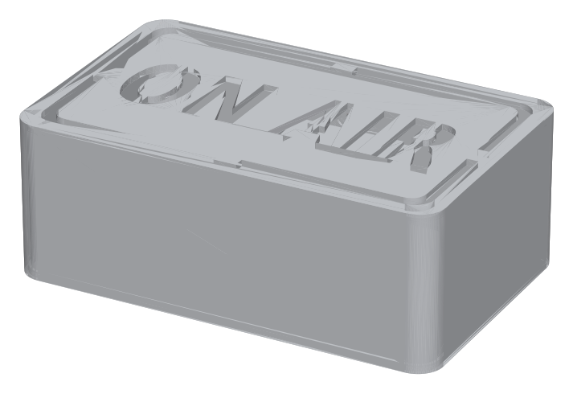
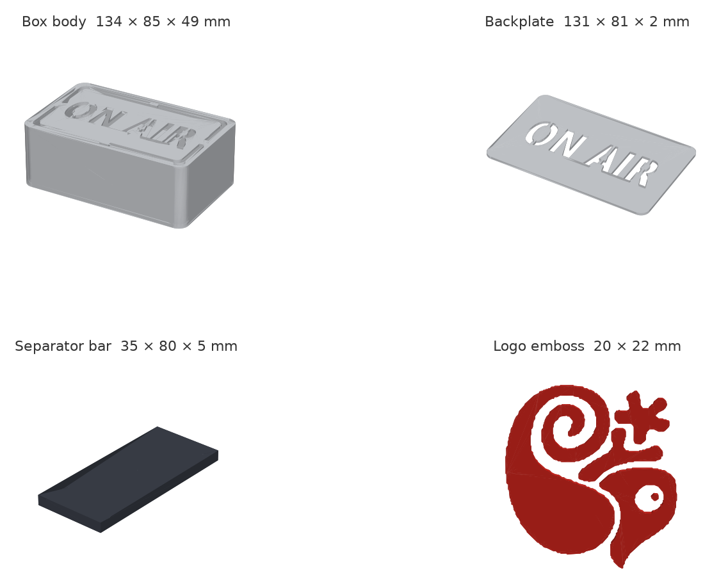

# On Air

**Kameran ya da mikrofonun açılınca kapıdaki "On Air" ışığı yanar.** Düğme yok, elle açıp kapatmak
yok: küçük bir Windows uygulaması, Windows'un kendi gizlilik göstergesinin kullandığı sinyali izler
ve Bluetooth LE ile pilli, sekiz kırmızı LED'li bir ESP32-C3 tabelasına gönderir.

[English](README.md) · [Windows uygulaması ayrıntıları](windows/README.md) · [İndir](https://github.com/Guidin9/onair-ble/releases/latest)



Tabela, toplantı ya da görüntülü görüşme sırasında odaya girecek kişileri uyarmak için yapıldı.
Her şey bu repoda: Windows uygulaması, cihaz yazılımı (firmware), LED test sketch'i ve 3D baskıya
hazır kutu dosyaları.

## Nasıl çalışır

```
 Windows PC                                            On Air tabelası (ESP32-C3)
┌──────────────────────────────────────┐              ┌──────────────────────────────┐
│ Kamera / mikrofon izin kaydı (HKCU)  │              │ GATT "state" karakteristiği  │
│   LastUsedTimeStop == 0 → kullanımda │              │   şifreli + eşleşmiş yazma   │
│            │ RegNotifyChangeKeyValue │              │            │                 │
│            ▼                         │  Bluetooth   │            ▼                 │
│ OnAirIndicator.exe (tepsi uygulaması)│ ───────────▶ │ Kamera ya da mikrofon açıkken│
│   durum baytı: bit0 kamera, bit1 mik │  LE, 1 bayt  │ 8 kırmızı LED nefes alır     │
│   5 dakikada bir yeniden gönderim    │              │ 30 dk güvenlik zaman aşımı   │
└──────────────────────────────────────┘              └──────────────────────────────┘
```

1. Windows, her uygulama için kamera ve mikrofonun en son ne zaman açılıp kapandığını kaydeder.
   İzin kaydının herhangi bir yerinde `LastUsedTimeStop` değeri `0` ise cihaz şu an kullanılıyordur.
   Değişiklikleri kayıt defterinin kendisi bildirdiği için uygulama boştayken neredeyse hiç işlemci
   kullanmaz.
2. Değişiklikler 500 ms boyunca toplanır ve tek bir bayta çevrilir: bit 0 kamera, bit 1 mikrofon.
3. Bayt, tabelaya **şifreli ve eşleşmiş (bonded)** bir BLE bağlantısı üzerinden yazılır. Tabela,
   eşleşmediği hiçbir cihazdan gelen yazmayı kabul etmez.
4. Bayt sıfırdan farklıyken LED'ler nefes alır gibi yanıp söner. Bilgisayar ışığı kapatmadan ortadan
   kaybolursa (çökme, uyku, menzil dışı) 30 dakikalık güvenlik zaman aşımı ışığı kapatır. Uygulama
   durumu 5 dakikada bir yeniden gönderdiği için uzun bir toplantı bu sınıra takılmaz.

## Repoda neler var

| Klasör | Ne |
|---|---|
| [`windows/`](windows/) | Windows uygulaması: .NET 10, WinForms tepsi simgesi, WinRT Bluetooth. NuGet paketi yok. Yönetici izni olmadan kendini kurar ve kaldırır. |
| [`firmware/OnAir_BLE_C3/`](firmware/OnAir_BLE_C3/) | ESP32-C3 SuperMini için cihaz yazılımı (Arduino, NimBLE). |
| [`firmware/LED_Breathing_Test/`](firmware/LED_Breathing_Test/) | Donanım testi: BLE olmadan sadece LED'leri yakar, böylece kablolama hataları önceden bulunur. |
| [`hardware/enclosure/`](hardware/enclosure/) | 3D baskı kutu dosyaları (STL). GitHub'da dosyayı açınca 3B önizleme çıkar. |
| [`windows/docs/KURULUM-WINDOWS.md`](windows/docs/KURULUM-WINDOWS.md) | EXE'yi alan kişi için Türkçe kurulum rehberi; SmartScreen ve Akıllı Uygulama Denetimi uyarıları dahil. |

## Donanım

### Malzemeler

| Parça | Adet | Not |
|---|---|---|
| ESP32-C3 SuperMini | 1 | BLE 5.0, RISC-V. Pinleri uyarlarsan başka ESP32-C3 kartları da olur. |
| Kırmızı LED | 8 | Her GPIO'ya iki tane. |
| 330 Ω direnç | 8 | **Her LED'e bir tane.** Paralel LED'ler tek direnci paylaşırsa akımı biri çeker ve önce o yanar. |
| 100 kΩ direnç | 2 | Pil gerilimi bölücüsü. |
| 100 nF kondansatör | 1 | GPIO3 ile GND arasına. Olmazsa ADC, 50 kΩ'luk kaynak yüzünden düşük okur. |
| 1S Li-ion pil | 1 | 3,4–4,2 V. Aşağıdaki pil ömrü hesapları 3000 mAh içindir. |
| Güç anahtarı | 1 | Bölücü, anahtardan sonraki pil hattına bağlanır. |

### Bağlantılar

| ESP32-C3 pini | Bağlantı |
|---|---|
| GPIO5 | 330 Ω → kırmızı LED, ×2 → GND |
| GPIO6 | 330 Ω → kırmızı LED, ×2 → GND |
| GPIO7 | 330 Ω → kırmızı LED, ×2 → GND |
| GPIO10 | 330 Ω → kırmızı LED, ×2 → GND |
| GPIO3 | Pil ölçümü: anahtarlı pil hattından 100 kΩ / 100 kΩ bölücü, GND'ye 100 nF |
| GPIO9 | BOOT düğmesi (aktif düşük). 3 sn basılı tutunca eşleşmiş bütün bilgisayarları unutur. |

LED'lerin uzun bacağı (anot) GPIO'ya bakar. GPIO2 ve GPIO8 (strapping pinleri), GPIO20/21 (UART0)
ve GPIO18/19 (USB) kullanılmamalı.

### Kutu



| Dosya | Boyut (mm) | Ne işe yarar |
|---|---|---|
| [`onair_box_body_border_midpoint.stl`](hardware/enclosure/onair_box_body_border_midpoint.stl) | 134 × 85 × 49 | Ana kutu; ön yüzünde çerçeve içinde "ON AIR" yazısı var. |
| [`onair_backplate.stl`](hardware/enclosure/onair_backplate.stl) | 131 × 81 × 2 | "ON AIR" yazısı boydan boya kesilmiş plaka. |
| [`onair_backplate_mirrored.stl`](hardware/enclosure/onair_backplate_mirrored.stl) | 131 × 81 × 2 | Aynı plakanın ayna görüntüsü. |
| [`onair_separator_bar.stl`](hardware/enclosure/onair_separator_bar.stl) | 35 × 80 × 5 | Kutunun ortasından geçen ara bölme. |
| [`onair_logo_emboss.stl`](hardware/enclosure/onair_logo_emboss.stl) | 20 × 22 × 1,3 | Kutunun yanına gelen logo kabartması. Ayrı parça olduğu için başka renkte basılabilir. |

Kutu, ara bölme ve logo aynı koordinat sistemini kullanır; slicer'a birlikte aktarınca bölme ve logo
yerine oturur. [`hardware/enclosure/v1/`](hardware/enclosure/v1/) klasöründe 39 mm derinliğindeki
ilk sürüm duruyor.

## Firmware

### Derleme ve yükleme

1. Arduino IDE 2 ve **ESP32 Arduino core 3.x** (firmware `ledcAttach` kullanıyor, 2.x'te yok).
2. Kütüphane: **NimBLE-Arduino 2.x**.
3. Kart: *ESP32C3 Dev Module*, **USB CDC On Boot: Enabled**.
4. Önce [`LED_Breathing_Test`](firmware/LED_Breathing_Test/) yükle. Sekiz LED birlikte, 3 saniyede
   bir yavaşça yanıp sönmeli. `TEST_MODE 1` pinleri tek tek yakar, yanlış bağlanan pini bulmanı sağlar.
5. Sonra [`OnAir_BLE_C3`](firmware/OnAir_BLE_C3/) yükle. Kurulum sırasında `DEBUG_SERIAL` açık
   kalsın; 115200 baud'da MAC adresini ve `[BLE]` mesajlarını görürsün. Günlük kullanımda kapat.

> **Eşleşmeyi kaybetmeden güncelleme:** eşleşmeler NVS'de durur. *Tools → Erase All Flash Before
> Sketch Upload* **Disabled** kalırsa güncelleme onlara dokunmaz.

### LED'ler ne anlatıyor

| Durum | LED'ler |
|---|---|
| Yeni açıldı ya da bilgisayar bağlantıyı kopardı | 60 sn boyunca 3 saniyede bir iki kısa, sönük yanıp sönme, sonra karanlık |
| Bağlı, kamera ve mikrofon kapalı | Karanlık. İşlemci hafif uykuya geçer. |
| Kamera ya da mikrofon açık | Sekizi birden nefes alır (gama düzeltmeli, 3 sn) |
| BOOT 3 sn basılı tutuldu | Onay yanıp sönmesi, bütün eşleşmeler silinir |

Bunun dışında ışık bilerek kapalı kalır: kapıdaki kırmızı ışığın tek bir anlamı olmalı.

### Bluetooth sözleşmesi

| | UUID | Özellikler |
|---|---|---|
| On Air servisi | `6f2a1b40-9c3e-4d17-8a52-b1c7e0f43d91` | |
| Durum karakteristiği | `6f2a1b41-9c3e-4d17-8a52-b1c7e0f43d91` | Şifreli okuma/yazma, bildirim. Tek bayt: bit 0 kamera, bit 1 mikrofon. |
| Pil servisi | `0x180F` (standart) | |
| Pil seviyesi | `0x2A19` (standart) | Okuma, bildirim. Yüzde olarak, 5 dakikada bir ölçülür. |

Eşleşme Just Works ve bonding ile yapılır, PIN sorulmaz. Cihaz yalnızca bağlı değilken yayın yapar
ve yayına sadece servis UUID'si girer; "On Air" adı tarama yanıtındadır. Yayın gücü +3 dBm, bir iki
metre ötedeki masa cihazı için yeterli.

### Güç tüketimi

Asıl tüketen LED'ler değil, işlemci: 330 Ω ile sekiz LED en fazla yaklaşık 34 mA çeker, nefes
eğrisi boyunca ortalaması 13 mA civarındadır. Bu yüzden pil ömrü hafif uykunun kullanılabilmesine
bağlı.

| Derleme | Boşta | Nefes alırken | Günlük (22 sa boşta, 2 sa açık) | 3000 mAh ile |
|---|---|---|---|---|
| Standart Arduino core (güç yönetimi yok), işlemci 80 MHz | ~20 mA | ~33 mA | ~505 mAh | ~6 gün |
| `CONFIG_PM_ENABLE` ile derlenmiş core (özel sdkconfig, PlatformIO ya da ESP-IDF) | ~2 mA | ~33 mA | ~110 mAh | ~4 hafta |

Bunlar firmware'deki güç hesabından gelen tahminler, uzun süreli ölçüm değil. Standart Arduino
core'da güç yönetimi kapalı gelir; firmware bunu fark eder, bir kez loglar ve çalışmaya devam eder.
Karttaki güç LED'ini sökmek 1–3 mA daha kazandırır.

## Windows uygulaması

[Son sürümden](https://github.com/Guidin9/onair-ble/releases/latest) `OnAirIndicator.exe`'yi indir
ve çalıştır. Açılan küçük pencerede **Install** uygulamayı `%LOCALAPPDATA%\OnAir` klasörüne kopyalar,
oturum açılışında başlatır ve tabelayla kendisi eşleşir. Yönetici izni gerekmez; **Uninstall** de
Bluetooth eşleşmesi dahil her şeyi geri alır.

| Komut | Ne yapar |
|---|---|
| `OnAirIndicator.exe` | Kur / Kaldır penceresini açar |
| `OnAirIndicator.exe --install` | Pencere açmadan kurar |
| `OnAirIndicator.exe --uninstall` | Uygulamayı, otomatik başlatmayı ve eşleşmeyi kaldırır |

Tepsi simgesi bağlantıyı, pil seviyesini ve kamera/mikrofon durumunu gösterir. Sorun olursa
**Re-pair device** ve **Reconnect now** seçenekleri var. Loglar 7 gün boyunca
`%LOCALAPPDATA%\OnAir\logs` klasöründe tutulur.

Sürümdeki EXE kendi ürettiğim bir sertifikayla imzalı; bu yüzden Windows ilk açılışta SmartScreen
uyarısı gösterebilir. *Daha fazla bilgi → Yine de çalıştır* de ya da `Unblock-File .\OnAirIndicator.exe`
çalıştır. Daha nadir görülen Akıllı Uygulama Denetimi engeli dahil ayrıntılar
[`windows/docs/KURULUM-WINDOWS.md`](windows/docs/KURULUM-WINDOWS.md) dosyasında.

### Kendin derle

Windows 10 2004 veya üstü ve .NET 10 SDK gerekir.

```powershell
cd windows
dotnet publish -c Release -r win-x64 --self-contained true `
  -p:PublishSingleFile=true -p:IncludeNativeLibrariesForSelfExtract=true
```

Sonuç, `bin\Release\net10.0-windows10.0.19041.0\win-x64\publish\` altında ~55 MB'lık tek bir EXE.
Bunun neredeyse tamamı .NET çalışma ortamı; uygulamanın kendisi yaklaşık 0,2 MB.

Mimari notları, yeniden bağlanma kuralları ve thread modeli [`CLAUDE.md`](CLAUDE.md) ile
[`windows/README.md`](windows/README.md) dosyalarında (İngilizce).

## Lisans

[MIT](LICENSE) © 2026 Mert Demirdöven
